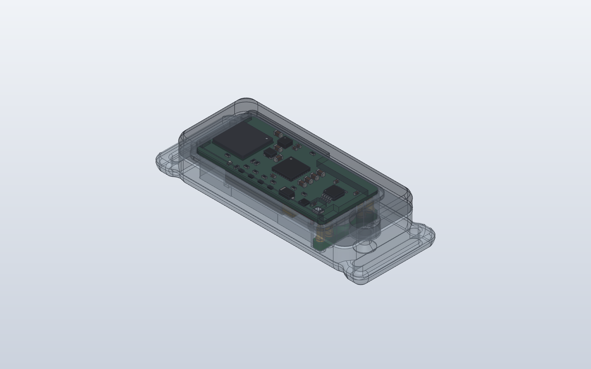
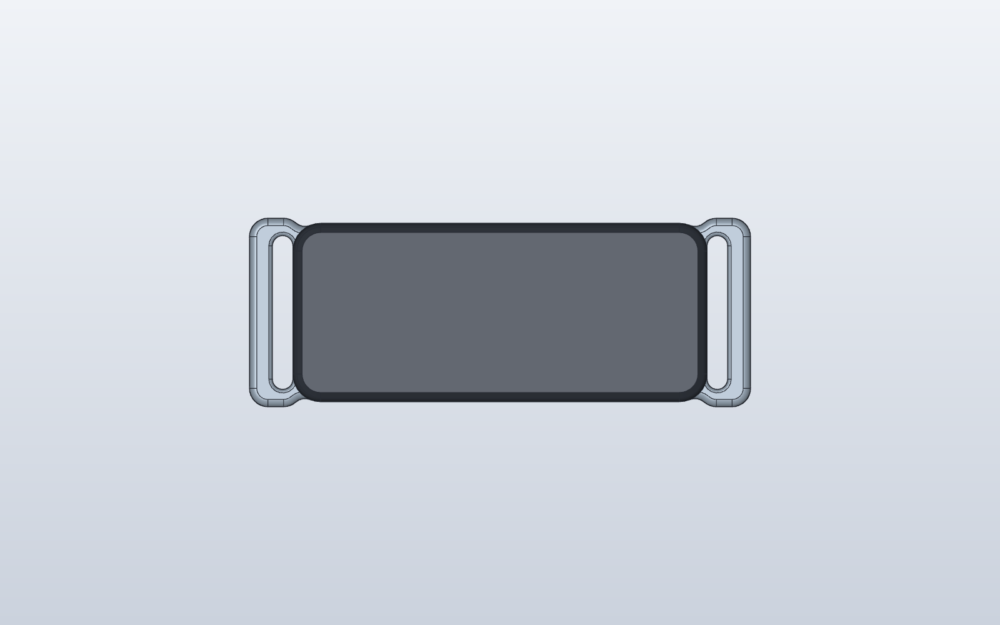
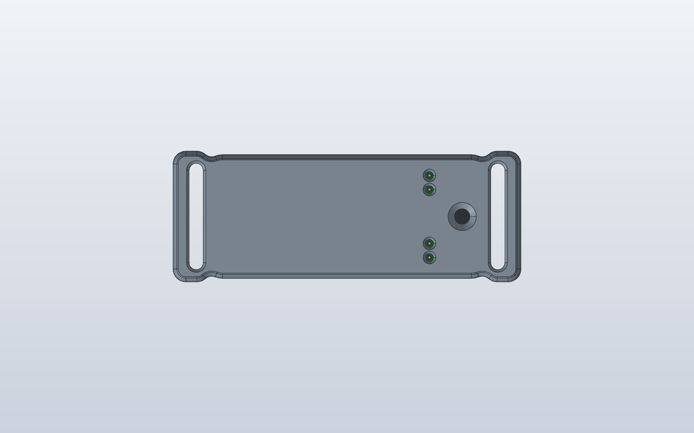
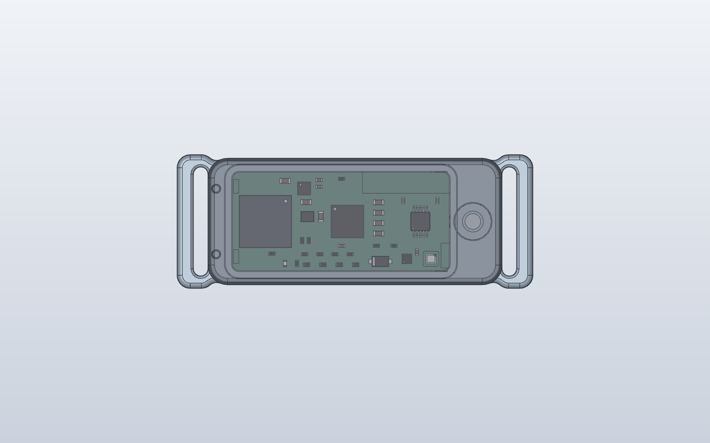

# WakeBand case rev A

Two printed parts for the [rigid rev A board](../pcb/README.md),
joined by a stepped ridge all round and held by one M2 screw. The board
mounts **parts side out**:

- the **shell** covers F.Cu and the parts. Its top is closed: the only
  feature is a 0.4 mm skin over the charge LED;
- the **wrist cover** holds the cell and the LRA under B.Cu, and carries the
  **four dock contacts** and the **two dock magnets** on the wrist side.

| Part | File | Size (x, y, z) |
| --- | --- | --- |
| Outer shell | `wakeband-case-rev-a-shell.step` / `.stl` | 44.8 x 19.3 x 4.0 mm, plus the screw boss down to z 3.5 |
| Wrist cover with strap loops | `wakeband-case-rev-a-cover.step` / `.stl` | 54.2 x 20.4 x 6.7 mm |
| Contact carrier PCB (for the assembly) | `wakeband-case-rev-a-contact-carrier.step` | 2.2 x 15.1 x 1.6 mm, see `../contact-carrier` |
| Spring pins (4, for the assembly) | `wakeband-case-rev-a-spring-pins.step` | Mill-Max 0906-2, shown compressed |
| Magnets (2, for the assembly) | `wakeband-case-rev-a-magnets.step` | Ø3 x 1 mm each |
| Assembled | | **44.8 x 19.3 x 10.0 mm** body, 54.2 x 20.4 mm with the strap loops (unchanged by the wrist-side contacts) |

`case_rev_a.py` (build123d) makes both parts and the assembly models. From
this folder:

    pip install build123d
    python case_rev_a.py OUT_DIR BOARD_STEP CELL_STEP LRA_STEP

The three STEP files are optional. Pass them to also check the case, the
carrier, the spring pins and the magnets for clashes against the board, the
cell and the LRA. Use the board's KiCad STEP export, plus the cell and LRA
files from `../pcb/wakeband.3dshapes/make_placed.py`.

The script designs in KiCad x/y with z = 0 at the wrist face. It then
mirrors y, so the parts land on the board's STEP export lifted by
z = 6.7 mm.

## Stack as worn

| Layer | z (mm) |
| --- | --- |
| shell top, outer face | 10.0 |
| inside of the shell top (F parts up to 1.1 mm, plus 0.2 mm) | 8.8 |
| F.Cu, parts up | 7.5 |
| B.Cu, the split between shell and cover (landing pads for the spring pins) | 6.7 |
| cell and LRA, 0.2 mm below B.Cu | 6.5 |
| contact carrier top / spring-pin flanges | 2.3 |
| contact carrier underside (floor step) | 0.7 |
| spring-pin tails, the dock contact targets | 0.55 |
| wrist face | 0 |

## Dock contacts (wrist side)

**How they embed and connect.** Four Mill-Max **0906-2** spring pins sit in
a small **contact carrier PCB** (1.6 mm FR4, four plated 0.6 mm holes)
that is glued into a pocket in the wrist cover beside the LRA:

- The pin's **flange** rests on the carrier's top pad and is soldered there.
- Its **solder tail** (Ø0.43 mm, 1.75 mm long) goes down through the carrier
  and ends 0.55 mm inside the wrist face, at the top of a **cone window**
  (Ø2.0 mm at the skin, Ø1.2 mm at the tail). The tail end is the target
  the dock's spring pins press on; the cone guides them in.
- Its **plunger** points up and presses on a Ø1.6 mm ENIG **landing pad on
  the main board's B side** (J601). When the cover is screwed on, each pin is
  compressed by **0.60 mm** of its 1.40 mm stroke (mid-stroke is 0.70), so
  the contact holds through about ±0.6 mm of print, board and solder
  tolerance. Nothing is soldered to the main board, so the cover stays
  removable.

| Contact | Board pad (x, y) | Net |
| --- | --- | --- |
| 1 | (131.5, 101.1) | SWDCLK |
| 2 | (131.5, 103.3) | SWDIO |
| 3 | (131.5, 111.7) | GND |
| 4 | (131.5, 113.9) | VIN (5 V from the dock) |

The pairs sit 2.2 mm apart, either side of the LRA, all 26 mm from the
antenna keep-out. **Stack-up:** carrier underside 0.7, top 2.3; 0906-2
A = 5.00 mm (flange underside to free tip) puts the free tip at 7.30 against
B.Cu at 6.70, so compression 0.60 mm; the 1.75 mm tail ends at 0.55.

**Sweat and leakage.** The tails sit 0.55 mm back from the skin in their
windows, so they don't press on the skin, but sweat can still bridge a
pair. SWDIO (pulled up inside the nRF54L15) sits next to SWDCLK (pulled
down), so a wet bridge leaks a little current. Check this at bring-up: wet
a cloth with salt water, lay it across the four windows and measure the
band's sleep current. If it is too high, seal the windows with a thin bead
of silicone between charges, or move to a contact design with a switch.

## Magnetic dock

The dock (`../../../dock/rev-a/case`) holds the band **wrist side down**; its four
spring pins reach up into the cone windows.

- **Magnets:** two **Ø3 x 1 mm N42 or N52 disc magnets** (the buy list has N42) in the cover floor under
  the cell, on the centre line at x 112.5 and x 120.5 (y 107.5). Each sits
  in a Ø3.1 x 1.05 mm pocket under a 0.2 mm skin, in a 0.25 mm dome on the
  inside of the floor (the cell's foam takes it).
  - **Polarity:** the one at x 112.5 faces N towards the wrist, the one at
    x 120.5 faces S. The dock's magnets are reversed, so the band only
    seats one way round; turned end for end, both pairs repel.
  - **Antenna clearance:** the nearer magnet is 6 mm from the keep-out
    (x 100-105); no steel in the band.
- **LED:** with the band wrist side down, the charge LED in the shell top
  faces up and is seen directly while charging.

## Openings

None open into the band:

1. **Four contact windows** in the wrist face. Each is closed by the
   carrier PCB and its soldered pin; the carrier is sealed into its pocket
   with epoxy from the inside.
2. **The charge LED window is not an opening.** A 2.4 x 2.3 mm blind pocket
   leaves a **0.4 mm skin** of the shell top over D702.
3. **The screw hole** in the wrist face is filled by the countersunk M2
   screw, with the head 0.2 mm below flush.

The strap slots go through the strap loops only, outside the closed body.

## Charge LED

- **Window:** 0.4 mm skin over D702, from a pocket on the inside. The shell
  prints top face down, so the skin is the first 0.4 mm of the print.
- **Filament:** print the shell in white, natural or another light colour.
  Through black or dark PETG the LED will be hard to see.

## Joint (the ridge)

All round the parting line, the inner 0.95 mm of the cover wall stands
0.7 mm proud. It fits inside a 0.9 mm skirt on the shell with 0.15 mm
clearance, so the two halves slot together and can't slide sideways.

Below the ridge, a 0.5 mm ledge on the cover holds the board's B side at its
edge (notched round the spring pins). On the F side a land along the top
edge (over contacts 1 and 2), a post at the bottom right (over contacts 3
and 4) and two posts in the antenna keep-out strip press on the board, so
the four spring pins can't push it off the ledge.

## Fixing

- **One M2 x 6 countersunk screw** (ISO 10642 / DIN 7991, A2 stainless),
  from the wrist face at the LRA end (x = 136.6).
- It goes into a **brass M2 heat-set insert**, 3.0 mm long, in a Ø3.2 mm
  hole (for example Ruthex RX-M2x3). The insert sits in a Ø5.6 mm boss that
  hangs down from the shell into a pocket in the cover.
- **Self-tapping option:** set `INSERT_D = 1.6` and use an M2 x 6
  countersunk screw straight into the boss.
- **Antenna end:** two printed **press-fit pins** (Ø1.4 x 2.0 mm, 0.05 mm
  interference) go from the shell's skirt into the cover's end wall.
- **When worn,** the strap pulls the cover onto the wrist and the shell
  presses down onto it, so the joint stays closed.

## Hardware

| Item | Spec |
| --- | --- |
| Spring pins | 4 x Mill-Max **0906-2-15-20-75-14-11-0** (through-hole, gold, 1.40 mm stroke, standard-force spring 75; spring 72 is the low-force option). Check stock at Mill-Max, Digi-Key or Mouser |
| Contact carrier | `../contact-carrier` (JLCPCB, 1.6 mm, ENIG) |
| Magnets | 2 x Ø3 x 1 mm N42 or N52 disc, axially magnetized (see `../contact-carrier/BUY-LIST.md`) |
| Screw | M2 x 6 countersunk, ISO 10642 / DIN 7991, A2 stainless |
| Insert | M2 brass heat-set insert, 3.0 mm long, Ø3.2 mm hole |
| Foam | foam tape under the cell: 1.5 mm for a 4 mm cell, 0.5 mm for a 5 mm cell (0.25 mm less over the magnet domes) |
| Kapton | one layer over B.Cu under the cell and LRA, cut away round the four landing pads |
| Epoxy | **thick / gel** 2-part epoxy (not a thin, wicking one: it would run under the carrier into the windows and coat the contact tails) |
| Strap | see `../strap`: 16 mm wide, at most about 1 mm per layer where it folds round a loop bar (two layers pass the 2.2 mm slot) |

## Printing

| Setting | Value |
| --- | --- |
| Material | PETG (or ASA). PLA creeps at skin temperature. Shell in a light colour for the LED |
| Nozzle / layer | 0.4 mm / 0.12-0.16 mm |
| Walls | 4 perimeters (side walls 2.0 mm, top 1.2 mm, floor 1.0 mm) |
| Infill | 100 % |
| Supports | none |
| Shell | outer face (top) down on the bed |
| Cover | wrist face down on the bed; **pause at the first layer above z 1.25 mm** to drop in the magnets |

**Print check (2026-11-08, `../tools/printcheck.py`):** shell and cover are single solids with no
fragments, no overhang past 45 degrees, no bridges and no knife edges. Two fixes on 2026-11-08 (fit
unchanged): the antenna-end press-fit pins (shell) and their holes (cover) moved 0.2 mm inward so the
cover keeps 0.8 mm outside the holes, and the 0.5 mm web between the cover's screw-boss pocket and the
LRA cavity was opened into a slot. Intentional thin parts: the 0.2 mm skin under each magnet, the
0.25 mm cap printed over each magnet after the pause, the 0.7 mm floor under the contact carrier, the
0.4 mm LED skin, and 0.75 mm (for 0.7 mm of height) beside the heat-set insert hole.

Every edge that sits on the bed has a 45-degree chamfer with a round above
it. Nothing overhangs more than 45 degrees and nothing needs a bridge: the
cone windows narrow upward and the magnet skin is closed over the magnet
itself.

## Home build

**Tools:** soldering iron with a fine tip, tweezers, a 1.2 mm drill (by
hand, if the windows print small), gel epoxy, a reference magnet for
marking poles, a multimeter, and the assembled dock (for the final check;
it does not need to be powered).

1. **Print** both parts. During the cover print, at the pause above
   z 1.25 mm, drop the two magnets into their pockets: x 112.5 with N
   facing the bed, x 120.5 with S facing the bed (mark the poles with the
   reference magnet first). Resume; the plastic closes over them.
2. **Insert:** press the M2 insert into the shell's boss from below with
   the iron at about 230 C, flush with the end of the boss.
3. **Carrier in the cover.** Lay the carrier in its pocket (it is
   symmetric, so either end works). Drop the four spring pins in from the
   top, tail first.
4. **Seat the pins.** Stand the cover wrist side down on a flat surface.
   Gravity (or a light press with tweezers) seats every flange flat on the
   carrier, and the 0.6 mm plated holes keep the 0.43 mm tails centred to
   about 0.1 mm, so each pin stands square in its window.
   - Don't do this step on the dock: its spring pins would push up on the
     loose pins from below and lift them off the carrier.
5. **Solder** each flange to its carrier pad from the inside, with a little
   solder (keep it off the plunger). The carrier sits on PETG, so touch each
   joint briefly and let it cool before the next.
6. **Seal:** run a small bead of **gel epoxy** round the inside edge of the
   carrier and over the solder joints, keeping it off the plungers. Let it
   cure. Then set the cover on the dock and check with a multimeter that
   each of the dock's pins touches its tail.
7. **Board:** solder the cell to TP201 (+) and TP202 (-), and the LRA to
   TP501 (+) and TP502 (-), all on B. Put kapton over B.Cu with the four
   landing pads (x 131.5) left clear.
8. Lay the board in the shell, parts first. Stick the LRA onto the
   cover's pedestal between the arcs, and put foam tape in the cell bay.
9. Lower the cover straight onto the shell; the ridge locates it and the
   spring pins land on their pads. Fit the screw from the wrist side until
   snug.
10. **Check:** with a multimeter, measure from each window's tail to the
    matching board test point (VIN, GND) before the first charge.
11. Thread the strap through both loops.

## Checks (2026-11-07)

- **Clash check** against the board STEP with every part model, the cell,
  the LRA and their leads: no overlaps. The carrier, the spring pins and the
  magnets are clear of the board, cell, LRA, shell and cover.
- **Shell against cover:** the only overlap is the intended 0.05 mm press
  fit of the two pins (0.77 mm³).
- **Spring pins:** compression 0.60 of 1.40 mm when closed; tails 0.55 mm
  inside the wrist face.
- **Assembly path:** the cover lowered straight onto the shell touches
  nothing but the two antenna-end pins.
- Both parts are single, valid solids, and SolidCraft imports them as
  closed bodies.

## Compromises

1. **Bigger than the README budget** of about 35 x 17 x 9 mm. The body is
   44.8 x 19.3 x 10.0 mm because of the 2.0 mm walls that carry the ridge,
   room for a 5 mm cell plus foam, 0.2 mm clearances, the screw boss past
   the LRA end and the 3.6 mm antenna end wall.
2. **Contacts on the wrist face** see sweat (see "Sweat and leakage"
   above). Test the sleep current with a wet bridge at bring-up.
3. **The antenna end is held by friction pins.** If the end gaps when the
   band is off the wrist, the next step is a second screw or a snap arm.
4. **Sealing depends on the epoxy round the carrier** and on the ridge
   joint. For more than sweat resistance, add a bead of silicone in the
   ridge.
5. **The LED shows through plastic, not an opening.** It is dimmer and more
   diffuse than through a hole, and depends on a light filament colour.
6. **The strap loops are wider than the body** (20.4 mm against 19.3 mm),
   because a 16 mm strap needs a 16.6 mm slot.
7. **The LRA pedestal is cut back** at x > 130.2 so the carrier drops in
   from above; the LRA's adhesive face is still supported over most of its
   area.
