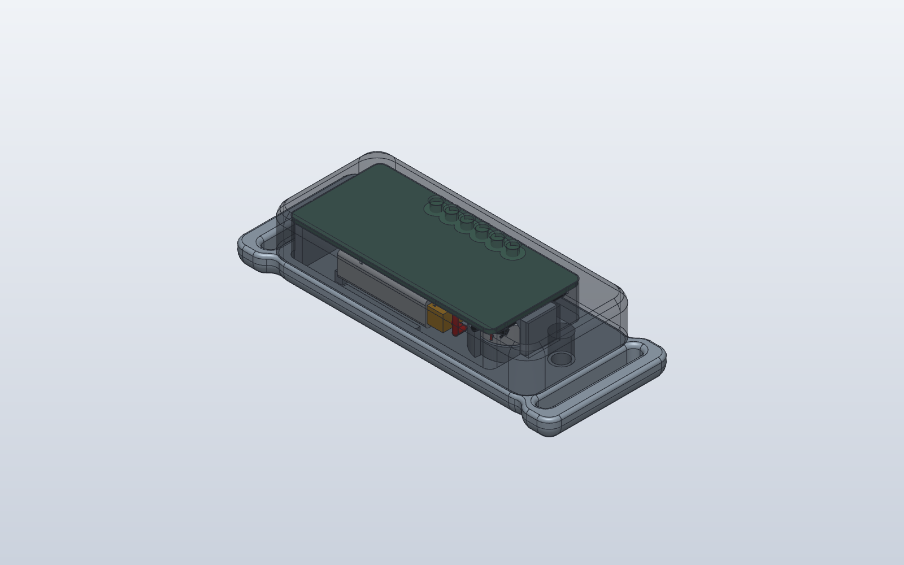
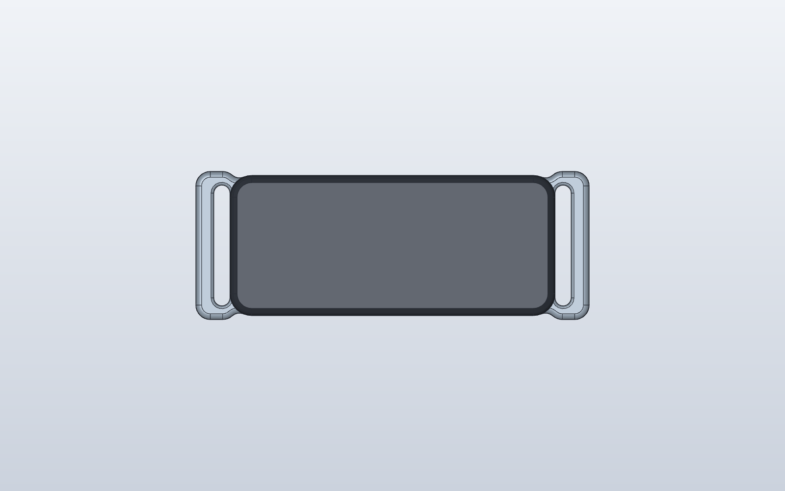
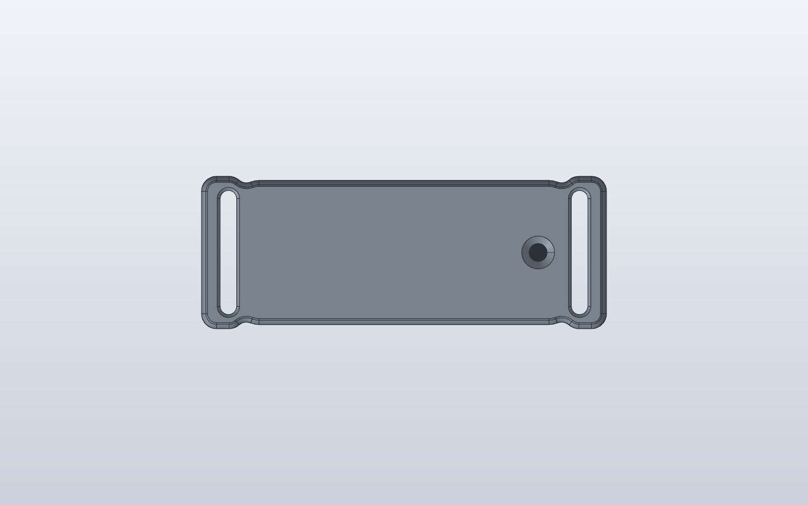

# WakeBand case rev A

Two printed parts for the [rigid rev A board](../rigid-rev-a/README.md),
joined by a stepped ridge all round and held by one M2 screw. Since the
2026-11-06 board rework the board mounts **parts side out**:

- the **shell** covers F.Cu, with the parts and the six dock pads;
- the **wrist cover** holds the cell and the LRA under B.Cu.

| Part | File | Size (x, y, z) |
| --- | --- | --- |
| Dock contacts (6 pins, for the assembly) | `wakeband-case-rev-a-dock-contacts.step` | Ø1.0 x 2.5 mm each |
| Magnets (2, for the assembly) | `wakeband-case-rev-a-magnets.step` | Ø3 x 1 mm each |
| Outer shell | `wakeband-case-rev-a-shell.step` / `.stl` | 44.8 x 19.3 x 4.0 mm, plus the screw boss down to z 3.5 |
| Wrist cover with strap loops | `wakeband-case-rev-a-cover.step` / `.stl` | 54.2 x 20.4 x 6.7 mm |
| Assembled | | **44.8 x 19.3 x 10.0 mm** body, 54.2 x 20.4 mm with the strap loops |

`case_rev_a.py` (build123d) makes both parts. From this folder:

    pip install build123d
    python case_rev_a.py OUT_DIR BOARD_STEP CELL_STEP LRA_STEP

The three STEP files are optional. Pass them to also check the case for
clashes against the board, the cell and the LRA. Use the board's KiCad STEP
export, plus the cell and LRA files from
`../rigid-rev-a/wakeband.3dshapes/make_placed.py`.

The script designs in KiCad x/y with z = 0 at the wrist face. It then
mirrors y, so the parts land on the board's STEP export lifted by
z = 6.7 mm.

## Stack as worn

| Layer | z (mm) |
| --- | --- |
| shell top, outer face (dock contacts flush) | 10.0 |
| inside of the shell top (F parts up to 1.1 mm, plus 0.2 mm) | 8.8 |
| F.Cu, parts up | 7.5 |
| B.Cu, the split between shell and cover | 6.7 |
| cell and LRA, 0.2 mm below B.Cu | 6.5 |
| room for a cell up to 5.0 mm, plus 0.5 mm foam | 1.0 |
| wrist face | 0 |

## Openings

None open:

1. **Six dock contacts set into the case top.** Each is a gold-plated
   Ø1.0 mm pin, 2.5 mm long, soldered upright on its dock pad J601 (pads
   Ø1.4 mm, 2.0 mm pitch, y = 101.6, x 121.75-131.75). The pin passes up
   through a Ø1.05 mm bore in the case top and ends flush with the outer face.
   - The bore is sealed with epoxy or UV resin, so no path is left for
     sweat.
   - Round the row, the case top (the dock land) sits right on the board.
     A 0.3 mm relief at each bore leaves room for the solder fillet.
   - The webs between bores are 0.95 mm.
2. **The screw hole** in the wrist face is filled by the countersunk M2
   screw, with the head 0.2 mm below flush.

The strap slots go through the strap loops only, outside the closed body.

## Magnetic dock

The band uses a magnetic pin system. The dock is in `../dock-rev-a`.

- **Contacts:** the six flush gold contacts are the targets. The dock's
  spring pins press on them.
- **Magnets:** two **Ø3 x 1 mm N52 disc magnets** are sealed in the case
  top at each end of the contact row, at x 118.6 and x 134.9 (y 101.6).
  - They sit in Ø3.1 x 1.05 mm pockets under a 0.2 mm skin, so nothing is
    open on the outside.
  - **Polarity:** the left one (antenna side) faces N outwards, the right
    one S. The dock's magnets are reversed, so the band only seats the right
    way round.
  - **Antenna clearance:** the left magnet is 13.6 mm from the antenna
    keep-out (x 100-105). The case has no steel.
- **Fitting the magnets:**
  - The shell prints top face down, so the pockets sit 0.2-1.25 mm above
    the bed.
  - Add a **print pause before the first layer above 1.25 mm**. Drop both
    magnets in with the poles as above, and resume. The plastic closes over
    the right magnet.
  - The left pocket also opens a little into the inside, so a drop of CA
    glue there holds that magnet too.

## Joint (the ridge)

All round the parting line, the inner 0.95 mm of the cover wall stands
0.7 mm proud. It fits inside a 0.9 mm skirt on the shell with 0.15 mm
clearance, so the two halves slot together and can't slide sideways.

Below the ridge, a 0.5 mm ledge on the cover holds the board's B side at its
edge. The dock land and two posts in the antenna keep-out strip press on the
F side. Together they clamp the board.

## Fixing

- **One M2 x 6 countersunk screw** (ISO 10642 / DIN 7991, A2 stainless),
  from the wrist face at the LRA end (x = 136.6).
- It goes into a **brass M2 heat-set insert**, 3.0 mm long, in a Ø3.2 mm
  hole (for example Ruthex RX-M2x3). The insert sits in a Ø5.6 mm boss that
  hangs down from the shell into a pocket in the cover.
- **Self-tapping option:** set `INSERT_D = 1.6` and use an M2 x 6
  countersunk screw straight into the boss.
- **Antenna end:** two printed **press-fit pins** (Ø1.4 x 2.0 mm, 0.05 mm
  interference) go from the shell's skirt into the cover's end wall. This
  is the only metal-free way to hold that end: the ISP2454 keep-out is
  x 100-105, and the screw and insert sit 30 mm away from it.
- **When worn,** the strap pulls the cover onto the wrist and the shell
  presses down onto it, so the joint stays closed.

## Hardware

| Item | Spec |
| --- | --- |
| Screw | M2 x 6 countersunk, ISO 10642 / DIN 7991, A2 stainless |
| Insert | M2 brass heat-set insert, 3.0 mm long, Ø3.2 mm hole |
| Foam | foam tape under the cell: 1.5 mm for a 4 mm cell, 0.5 mm for a 5 mm cell |
| Kapton | one layer over B.Cu under the cell and LRA (board README, compromise 6) |
| Strap | 16 mm velcro or fabric strap, up to 2 mm thick |
| Dock contacts | 6 x gold-plated brass pin, Ø1.0 mm x 2.5 mm (see below) |
| Seal | low-viscosity epoxy or UV-curing resin |
| Magnets | 2 x Ø3 x 1 mm N52 disc, axially magnetized (K&J, JC Magnetics, Magnet Baron) |

**Dock contact pins.** No catalogue pin is exactly Ø1.0 x 2.5 mm without a
collar wider than the 2.0 mm pitch allows. Spring pins such as the Mill-Max
0965 (Ø1.83 mm base) are too wide to sit side by side at that pitch. Use
one of these:

- Cut them from Ø1.02 mm gold-plated brass post pins, Mill-Max
  3340-0-00-15-00-00-03-0 (Digi-Key ED1142-ND, about US$0.20 each at 10,
  6.35 mm long). Check where its collar sits before cutting, and keep the
  plated, uncut end facing outwards.
- Or order gold-plated Ø1.0 mm brass pins cut to 2.5 mm from a pin maker.

**Dock side.** The dock needs six spring pins at 2.0 mm pitch whose
plungers touch these Ø1.0 mm contacts. Mill-Max 0965-0-15-20-80-14-11-0
(SMT, Ø1.07 mm plunger, 0.3 mm working stroke; Digi-Key ED1649-ND, about
CA$0.81 each at 10) fits on the dock board if its pads are kept small, or
use any 2.0 mm pitch pogo strip.

## Printing

| Setting | Value |
| --- | --- |
| Material | PETG (or ASA). PLA creeps at skin temperature |
| Nozzle / layer | 0.4 mm / 0.12-0.16 mm |
| Walls | 4 perimeters (side walls 2.0 mm, top 1.2 mm, floor 1.0 mm) |
| Infill | 100 % |
| Supports | none |
| Shell | outer face (top) down on the bed |
| Cover | wrist face down on the bed |

Every edge that sits on the bed has a 45-degree chamfer with a round above
it. Nothing overhangs more than 45 degrees, and nothing needs a bridge. The
Ø1.05 mm contact bores print slightly small: open them with a 1.05 mm
(#58) drill.
The two pins print standing up on the shell, so print them at 100 % infill.

## Assembly

1. Press the insert into the shell's boss from below with a soldering
   iron at about 230 C, flush with the end of the boss.
2. **Dock contacts.**
   - Put solder paste on the six dock pads.
   - Stand the six pins upright on the pads, using a jig: a strip with six
     Ø1.05 mm holes at 2.0 mm pitch, 2 mm thick, in FR4 or aluminium. Don't
     use the printed shell, because it would melt.
   - Reflow with hot air and check the pins stand square.
3. Solder the cell to TP201 (+) and TP202 (-), and the LRA to TP501 (+) and
   TP502 (-). All four pads are on B. Put kapton over B.Cu.
4. Lay the board in the shell, parts first, with the pins going up into
   their bores. Check that each pin end is flush with the outer face.
5. From outside, put a drop of thin epoxy or UV resin on each pin so it
   wicks into the bore, cure it, and wipe the face clean. Each contact is
   now sealed into the case.
6. Stick the LRA's adhesive face onto the cover's pedestal between the two
   arcs, lead tab towards TP501. Put foam tape in the cell bay.
7. Lower the cover straight onto the shell. The ridge locates it, and the
   two pins at the antenna end press into the cover's end wall.
8. Fit the screw from the wrist side and stop when it's snug.
9. Thread the strap through both loops.

## Checks (2026-11-06)

- **Clash check** against the board STEP (all part models except SW201,
  which is DNP), the cell, the LRA and their leads: no overlaps.
- **Shell against cover:** the only overlap is the intended 0.05 mm press
  fit of the two pins (0.77 mm³).
- **Wall thickness**, sampled by rays from several thousand surface points
  per part:
  - shell: top and land at least 1.0 mm; the ridge skirt 0.9 mm (0.6 mm at
    its edge chamfer); webs between contact bores 0.95 mm; boss wall 1.2 mm;
  - cover: floor 1.0 mm; the ridge lip and the board ledge 0.5 mm; about
    0.6 mm round the pin holes (0.33 mm at the seam chamfer); 0.5 mm web
    between the LRA bay and the screw-boss pocket; LRA arcs 0.5-0.8 mm.
- **Assembly path:** the cover lowered straight onto the shell touches
  nothing but the two pins, over their last 1.9 mm.
- **Contact pins:** they clear their bores (0.025 mm a side for the
  sealant) and don't touch the board, cell or LRA, other than resting on
  their pads.
- Both parts are single, valid solids, and SolidCraft imports them as
  closed bodies.

## Compromises

1. **Bigger than the README budget** of about 35 x 17 x 9 mm. The body is
   44.8 x 19.3 x 10.0 mm because of:
   - 2.0 mm side walls, which carry the ridge;
   - room for a 5 mm cell plus foam (`CELL_MAX = 4.0` makes it 9.0 mm tall);
   - 0.2 mm clearances over the F parts and under B;
   - the screw boss past the LRA end;
   - the 3.6 mm antenna end wall that holds the pins.
2. **The dock contacts need a small jig to solder upright**, and need
   resin sealing at assembly. They aren't a stock part (see Hardware).
3. **The antenna end is held by friction pins.** A tilt-in hook, as in the
   first version of this case, doesn't fit now that the board sits right at
   the joint. If the end gaps when the band is off the wrist, the next step
   is a second screw or a snap arm.
4. **Sealing depends on the resin at the six contacts** and on the ridge
   joint. For more than sweat resistance, add a thin gasket or a bead of
   silicone in the ridge.
5. **SW201 (DNP) must not be fitted:** at 1.6 mm it is taller than the
   1.1 mm the shell allows for.
6. **The strap loops are wider than the body** (20.4 mm against 19.3 mm),
   because a 16 mm strap needs a 16.6 mm slot.
