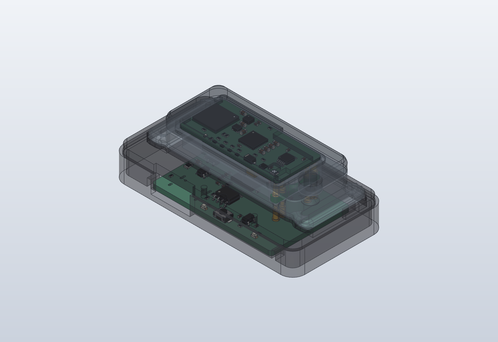
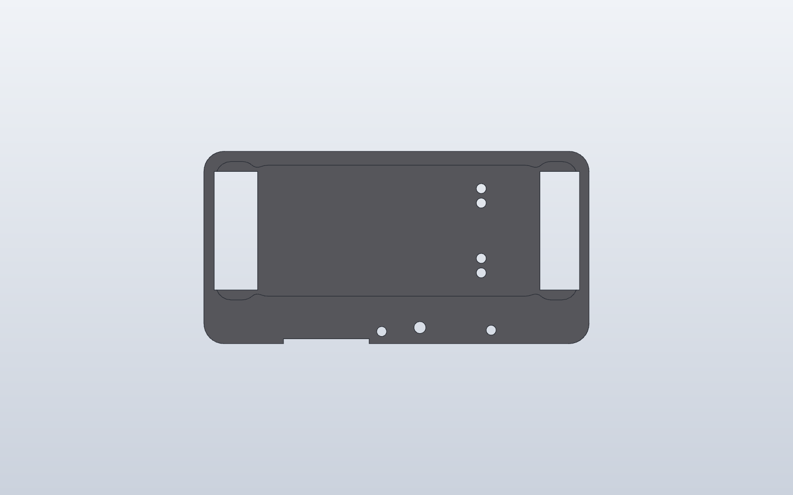
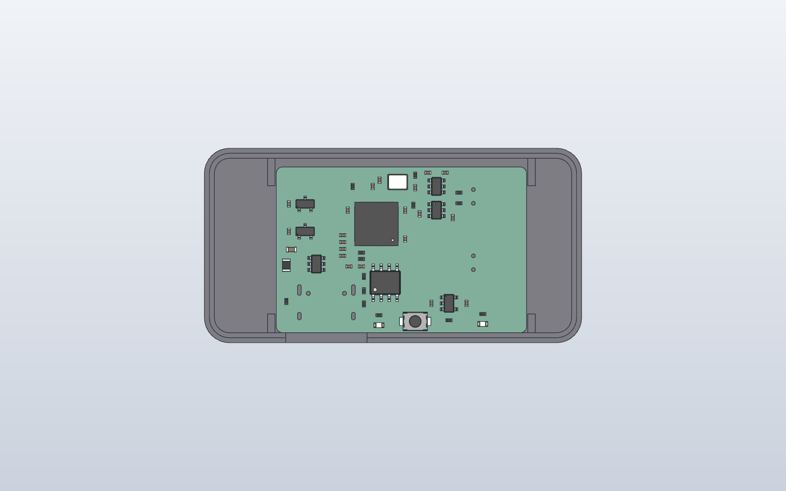

# WakeBand dock rev A

Charges the band and programs it from a computer over one USB-C cable.

You set the band **wrist side down** in the dock's recess. Two magnets pull
it in and line it up, and four spring pins press up through the band's
contact windows: **VIN, GND, SWDCLK, SWDIO**. The dock board is a
**USB CMSIS-DAP probe** (an RP2040 running Raspberry Pi's open-source
`debugprobe` firmware), so any SWD tool on the computer can flash the band
and read its log over **SEGGER RTT**. There is no serial port on the four
pins; RTT replaces it.

The magnets are keyed: turned end for end, the band is pushed away. The
band's charge LED faces up while it sits in the dock.

| Part | File |
| --- | --- |
| Top plate (recess, plunger guides, magnet pockets, LED and BOOTSEL holes, strap channels) | `wakeband-dock-rev-a-top.step` / `.stl` |
| Tray (PCB pocket, USB-C opening, rim) | `wakeband-dock-rev-a-tray.step` / `.stl` |
| Spring pins, magnets, PCB envelope (fit checks) | `wakeband-dock-rev-a-{spring-pins,magnets,pcb-envelope}.step` |
| Dock PCB | `pcb/` (KiCad 10 project, fab package in `pcb/fab/`) |

- **Size:** 60.3 x 31.1 x 9.7 mm.
- **Frames:** STEP files are in the band's assembly frame, docked under the
  band (the band's wrist face at z = 0).
- **Regenerate:** `python dock_rev_a.py OUT_DIR` (needs build123d and
  `../case-rev-a`).
- **Checks:** the top plate, tray, spring pins, magnets and the dock PCB's
  KiCad model (every part) don't clash with each other or with the band's
  wrist cover; both printed parts are single valid solids.

## How it fits together

| z (mm, band frame) | |
| --- | --- |
| +1.5 | dock top, recess rim |
| +0.55 | band contact tails; dock plunger tips (0.70 mm compressed = mid-stroke) |
| 0 | band wrist face = recess floor |
| -0.2 / -1.25 | dock magnets (0.2 mm skin) |
| -1.3 | underside of the top plate (ceiling over the parts) |
| -4.74 | dock PCB top (Mill-Max 0906-4 flanges) |
| -6.34 | dock PCB bottom |
| -8.24 | bottom of the tray |

- **Spring pins:** 4 x Mill-Max **0906-4-15-20-72-14-11-0** (through-hole, low-force spring 72,
  1.40 mm stroke) on the dock PCB at the band's contact positions
  (x 131.5, y 101.1 / 103.3 / 111.7 / 113.9). Their plungers rise through
  Ø1.5 mm guide bores in the top plate; when the band is down they are at
  mid-stroke (0.70 mm).
- **Magnets:** 2 x Ø3 x 1 mm N52 at (112.5, 107.5) and (120.5, 107.5),
  pressed into pockets from the underside of the top plate (0.2 mm skin on
  top). **Polarity:** the one at x 112.5 faces **S up**, the one at x 120.5
  faces **N up** (opposite to the band's).
- **Strap:** two 18 mm channels, 2.6 mm deep, run under the strap loops and
  out of both ends, so a strap can stay on the band while it docks.
- **LEDs and BOOTSEL:** light holes over D1 (USB) and D2 (activity) and a
  poke hole over the BOOTSEL button, all in the top margin on the USB-C
  side.
- **USB-C:** both parts are notched 13 mm wide in front of the receptacle,
  so its face sits at the dock's edge and a normal cable plugs fully home.
- **Spring force against the magnets:** the dock pins use the low-force
  spring (72) so the four of them at mid-stroke don't lift the band off the
  two magnet pairs. This hasn't been measured: at bring-up, check that the
  band stays seated and charges when the dock is tilted and tapped. If it
  lifts, fit Ø4 x 1.5 mm magnets in the dock (there is room under the
  recess) or shorten the dock pins' stroke with a thinner top plate.

## Dock PCB (`pcb/`)

4-layer 1.6 mm, 40 x 26.5 mm, all parts on the top side for JLCPCB
assembly; the four spring pins are hand-soldered.

| Block | Parts (LCSC) | Notes |
| --- | --- | --- |
| USB-C | HRO TYPE-C-31-M-12 (C165948), 2 x 5.1 k CC pull-downs (C25905), USBLC6-2SC6 (C7519), 2 x 27 R (C25100) | USB 2.0 device, 5 V sink |
| Input | 500 mA PTC FSMD050-0805 (C181350), 10 uF (C19702) | |
| Probe | RP2040 (C2040), W25Q16JVSNIQ 2 MB flash (C2456211), 12 MHz crystal (C2981639) + 2 x 15 pF, BOOTSEL TS-1088 (C720477) | Raspberry Pi Debug Probe pin map: SWCLK GPIO12, SWDI GPIO13, SWDIO GPIO14, LEDs GPIO2 (USB) and GPIO16 (DAP running) |
| Rails | XC6206P332MR 3.3 V (C2897477), XC6206P182MR 1.8 V (C21659) | |
| SWD level shift | 74LVC1T45 (C168856) for SWCLK, TXS0101 (C132604) for SWDIO, 22 R series | band side at 1.8 V, so 3.3 V never reaches the band |
| Band power | SY6280AAC (C55136), Rset 15 k (C25756) | current-limited switch, about 0.45 A (the part's minimum is 0.4 A), behind the PTC |
| Pins | 4 x Mill-Max 0906-4-15-20-72-14-11-0 | hand-soldered; the GND pin (P3) has a thermal relief so it solders by hand |

**Why these translators.** The stock firmware has no direction pin for
SWDIO (GPIO14 drives, GPIO13 reads the same line), so SWDIO needs an
auto-direction part: the TXS0101. SWCLK only goes out, and the nRF54L15
pulls it down internally, which would fight a TXS's weak pull-up, so it gets
a fixed-direction 74LVC1T45.

**Checks:** ERC 0; DRC with schematic parity 0 violations, 0 unconnected,
0 parity. The schematic and board are generated from `pcb/scripts/`
(`parts.py` is the netlist and BOM source; `gen_sch.py`, `gen_pcb.py`,
`placement.json`), then routed with a grid router plus a hand-laid QSPI
fan-out, and ground-stitched to the solid In1 plane.

**Trace audit (not yet at the band's standard):** every segment is at 0, 45
or 90 degrees, but the router left about 30 cosmetic items: short 0.2-0.3 mm
stair-steps round the RP2040, about a dozen track ends inside a pad but off
its centre, and three ends that join a track mid-span. They pass DRC and
don't affect function; tidy them in KiCad before a production run.

**Cost (rough, JLCPCB, 5 boards):** board about US$10 for a small 4-layer
order; parts about US$4 a board (RP2040 0.90, flash 1.00, crystal 0.09, the
rest cents each) plus about US$3 setup per extended part type (about 12);
spring pins a few US$ each from distributors (4 a dock).

**Fab:** `pcb/fab/dock-pcb-rev-a-fab.zip` (Gerbers, drill, `bom_jlcpcb.csv`,
`cpl_jlcpcb.csv`). The CPL leaves out the spring pins and test pads. Check
the RP2040, SOT-23 parts and USB-C rotations in the JLCPCB preview.

## Power notes

- USB 5 V goes through the PTC to the SY6280 switch and out to the band's
  VIN pin; the band's nPM1304 does the charging (firmware sets the charge
  current, see the board README).
- If the band's pins short, the switch limits at about 0.45 A and the PTC
  backs it up.
- The probe side draws about 30-40 mA from USB.
- The band's SWD lines see 1.8 V from the dock. The band's I/O runs at
  2.0 V, which reads 1.8 V as high, and the TXS0101 accepts the band's 2.0 V.

## Flashing the dock (once)

1. Download `debugprobe.uf2` from the latest release of
   https://github.com/raspberrypi/debugprobe (the build for the Raspberry Pi
   Debug Probe; this board copies its pin map, so no rebuild is needed).
2. Hold **BOOTSEL** (a pin through the poke hole) and plug in USB-C. The
   dock appears as a drive called `RPI-RP2`.
3. Copy `debugprobe.uf2` onto it. The dock restarts as "Debug Probe
   (CMSIS-DAP)", and the USB LED (D1) lights.
4. **Recovery:** if the RP2040 won't show the drive, the pads on the
   underside of the dock PCB (TP1 SWCLK, TP2 SWDIO, TP3 RUN, TP4 GND) give
   direct SWD access to the RP2040.

## Programming the band

Put the band in the dock, then use any CMSIS-DAP tool. Check these on the
nRF54L15 DK first; nRF54L15 support is recent in each tool:

- **probe-rs:** `probe-rs download --chip nRF54L15 --binary-format hex app.hex`
  (or give it the `.elf`), then `probe-rs reset --chip nRF54L15`.
- **Logs over RTT:** `probe-rs attach --chip nRF54L15 app.elf` prints the
  RTT channels; with Zephyr, enable `CONFIG_USE_SEGGER_RTT` and the RTT log
  backend.
- **Zephyr:** `west flash --runner pyocd` (or the probe-rs runner if your
  Zephyr version has it).
- **pyOCD:** `pyocd flash -t nrf54l15 app.hex` once the nRF54L target
  support is installed.
- **Locked part:** if the nRF54L15's access port protection is on, erase it
  with the tool's recover / erase-all command before flashing.

There is no reset pin on the dock; the tools reset the chip over SWD.

## Assembly

1. Order the PCB assembled (top side) from `pcb/fab/`; solder the four
   0906-4 spring pins by hand, flanges flat on the board.
2. Print the top plate and the tray, both flat on their underside (no
   supports). PETG or PLA (the dock is not worn).
3. Press the two magnets into the top plate's pockets from below with the
   poles as above, with a drop of CA glue.
4. Lay the PCB in the tray on its four pads (USB-C into its opening),
   flash it (above), then drop the top plate into the tray's rim, guiding
   the plungers into their bores. Glue the plate in once everything works.
