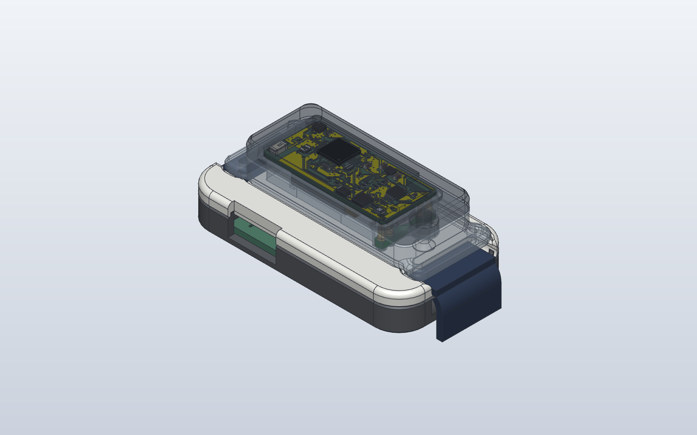
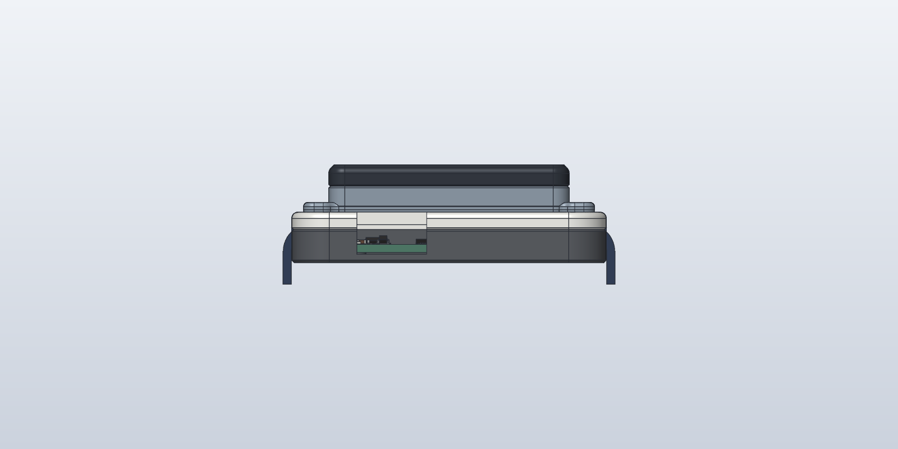
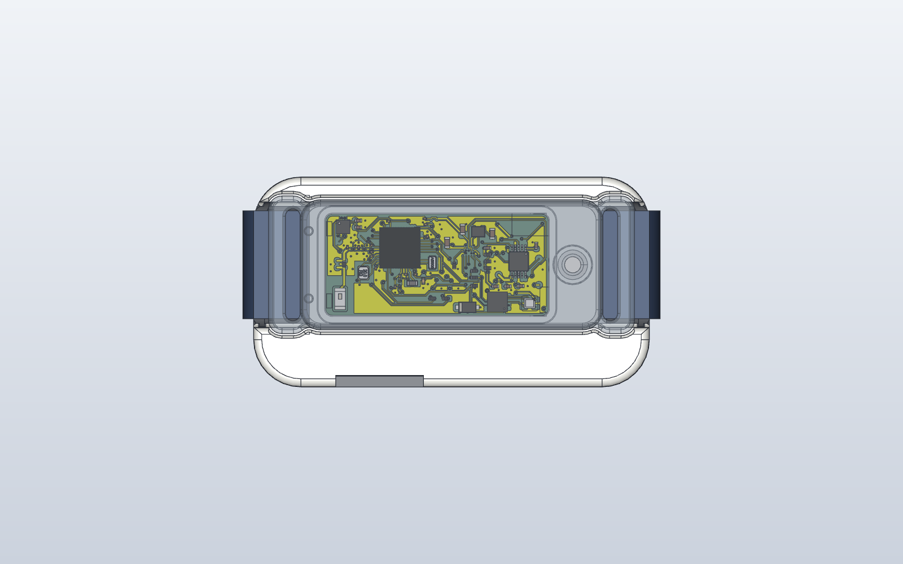
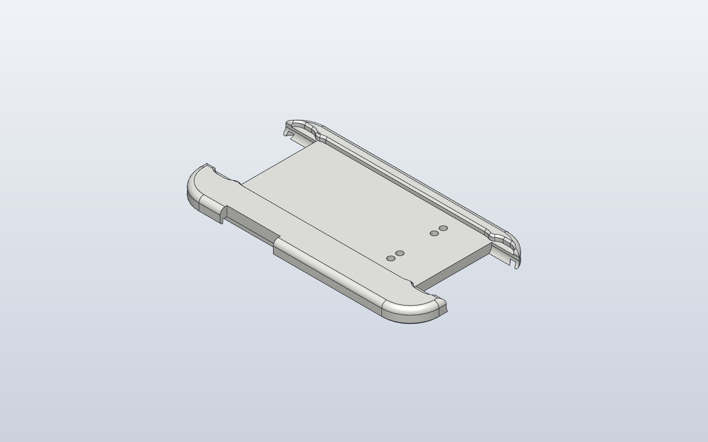

# WakeBand dock rev B

The charging and programming dock, restyled for everyday use. Same electronics as rev A: the dock PCB
in `../dock-rev-a/pcb` (USB-C, RP2040 CMSIS-DAP probe, current-limited band power), the same four
spring-pin positions and the same keyed magnets. See the [rev A README](../dock-rev-a/README.md) for
the PCB, flashing the dock and programming the band.

**Size:** 58.6 x 31.1 x 9.4 mm (rev A 60.3 x 31.1 x 9.7).

## What changed from rev A

| | Rev A | Rev B |
| --- | --- | --- |
| Outline | 4 mm corners, square top edge | 7 mm corners, 1.2 mm round on the top edge, 0.5 mm chamfer at the bottom |
| Joint | top plate inside a raised tray rim: a step and a seam on top | top plate covers the whole outline and sits on a hidden lip; the only joint is a fine shadow line on the side, 3.25 mm below the top |
| Strap | 18 mm box channels, sharp edges, open into the hollow inside | 18.6 mm channels (16 mm strap) with rounded floor corners and rounded lips, a **3.5 mm rounded saddle at each end** so the strap drapes down and out, and solid channel floors |
| LEDs | holes | shine through a **0.4 mm skin** (no holes) |
| BOOTSEL | poke hole on top | no hole (see below) |
| Magnets | Ø3 x 1 mm N52 | **Ø4 x 1.5 mm N52**, pockets Ø4.1 x 1.55 from below, 0.2 mm skin, same positions and polarity |
| Recess | 1.5 mm deep | 1.2 mm deep with a 0.4 mm lead-in chamfer |
| Underneath | flat | four Ø8.2 x 0.6 mm recesses for Ø8 mm self-adhesive rubber feet |

**Why bigger magnets:** the dock spring pins changed to the stocked Mill-Max
**0906-4-15-20-75-14-11-0** (the low-force -72 is a factory special order). The -75 pushes about
60 g each at mid-stroke, 240 g for four, against 180 g for the -72. Ø4 x 1.5 mm N52 magnets pull
roughly twice as hard as Ø3 x 1 mm against the band's Ø3 x 1 mm magnets through the same gap. At
bring-up, tilt and tap the dock with the band in it: the band must stay seated and charging.

**BOOTSEL:** the button sits on top of the PCB, so it can't be reached from underneath without a PCB
change. A press-through skin would need about 1 mm of flex, which a printed skin won't give reliably.
So the top stays clean: flash the dock (rev A README, "Flashing the dock") **before** fitting the top
plate. To re-flash, lift the top plate off; it is held by the lip, so don't glue it.

## Parts

| File | What |
| --- | --- |
| `wakeband-dock-rev-b-top.step` / `.stl` | top plate (print this) |
| `wakeband-dock-rev-b-tray.step` / `.stl` | tray (print this) |
| `wakeband-dock-rev-b-magnets.step`, `-spring-pins.step` | fit-check models |
| `wakeband-dock-rev-b-strap-standin.step` | 16 x 1.5 mm strap stand-in for the previews |
| `dock_rev_b.py` | builds all of the above; `python dock_rev_b.py OUT_DIR [DOCK_PCB_STEP]` |

To buy (see `../contact-carrier-rev-a/BUY-LIST.md`): the dock PCB (`../dock-rev-a/pcb/fab`), 4 x Mill-Max
0906-4-15-20-75-14-11-0, 2 x Ø4 x 1.5 mm N52 disc magnets, 4 x Ø8 mm self-adhesive rubber feet.

## Printing

PETG (or PLA: the dock is not worn), no supports.
- **Top plate:** underside down. The underside is flat; the magnet pockets and LED windows open
  downward, so nothing overhangs.
- **Tray:** floor down.
- Print the top plate in a light or translucent colour so the LEDs show through the 0.4 mm skin.

## Assembly

1. Solder the four spring pins to the dock PCB (flanges flat), flash it, and lay it in the tray
   (USB-C into its opening).
2. Press the magnets into the top plate's pockets from below with a drop of CA glue: the one at
   x 112.5 **S up**, the one at x 120.5 **N up** (opposite to the band's). Check the band only seats
   one way round before the glue sets.
3. Press the top plate onto the tray's lip, guiding the plungers into their bores.
4. Stick the rubber feet into the four recesses underneath.

## Checks (2026-11-08)

- Both printed parts are single valid solids; top plate and tray don't overlap.
- Clash check against the dock PCB's KiCad model (every part), the spring pins, the magnets and the
  band's wrist cover: **0 overlaps**. Tallest PCB part (BOOTSEL) is 0.7 mm under the top plate.
- Spring pins at **mid-stroke** (0.70 of 1.40 mm) when the band is seated, as rev A.
