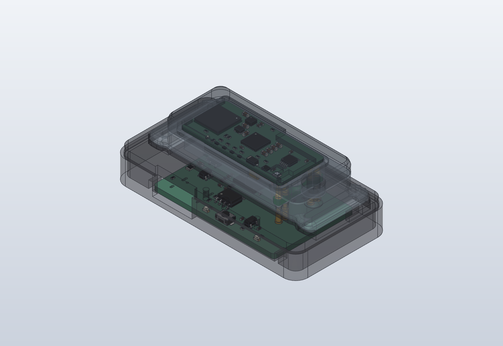
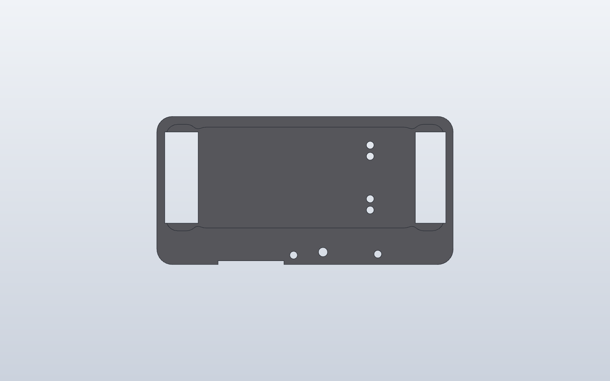
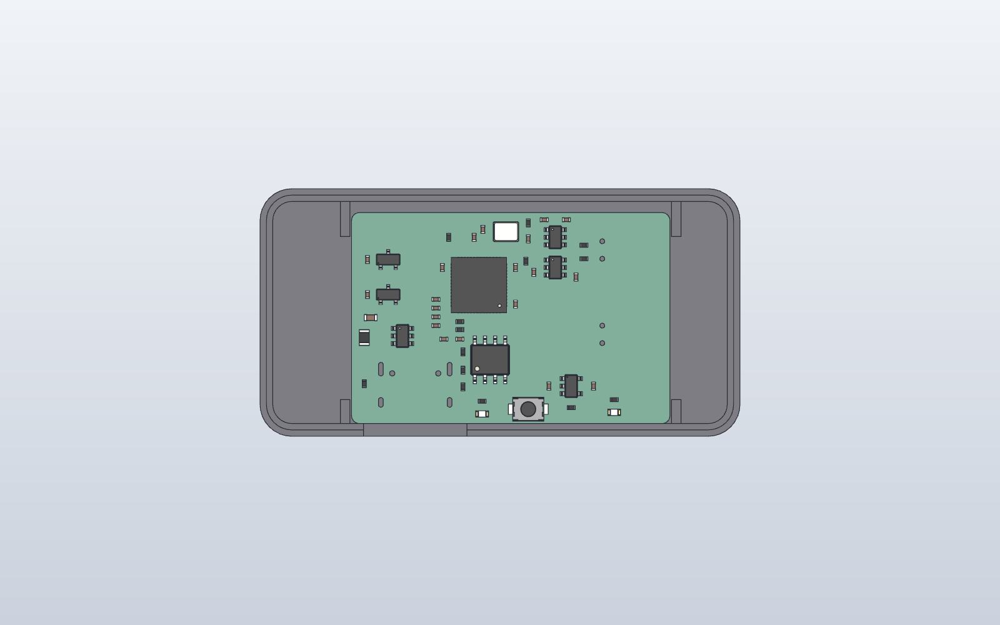

# WakeBand dock rev A

> **Superseded for printing by [dock rev B](../../rev-b/case)** (sleeker shell, strap saddles, Ø4 x 1.5 mm
> magnets). The dock PCB is in [`../pcb`](../pcb), used by both.

Charges the band and programs it from a computer over one USB-C cable.

You set the band **wrist side down** in the dock's recess. Two magnets pull
it in and line it up, and four spring pins press up through the band's
contact windows: **VIN, GND, SWDCLK, SWDIO**. The dock board is a
**USB CMSIS-DAP probe** (an RP2040 running Raspberry Pi's open-source
`debugprobe` firmware), so any SWD tool on the computer can flash the band
and read its log over **SEGGER RTT**. There is no serial port on the four
pins; RTT replaces it.

The magnets are keyed: turned end for end, the band is pushed away. The
band's charge LED faces up while it sits in the dock.

| Part | File |
| --- | --- |
| Top plate (recess, plunger guides, magnet pockets, LED and BOOTSEL holes, strap channels) | `wakeband-dock-rev-a-top.step` / `.stl` |
| Tray (PCB pocket, USB-C opening, rim) | `wakeband-dock-rev-a-tray.step` / `.stl` |
| Spring pins, magnets, PCB envelope (fit checks) | `wakeband-dock-rev-a-{spring-pins,magnets,pcb-envelope}.step` |
| Dock PCB | [`../pcb`](../pcb) (KiCad 10 project, fab package in `fab/`) |

- **Size:** 60.3 x 31.1 x 9.7 mm.
- **Frames:** STEP files are in the band's assembly frame, docked under the
  band (the band's wrist face at z = 0).
- **Regenerate:** `python dock_rev_a.py OUT_DIR` (needs build123d and
  `../../../band/rev-a/case`).
- **Checks:** the top plate, tray, spring pins, magnets and the dock PCB's
  KiCad model (every part) don't clash with each other or with the band's
  wrist cover; both printed parts are single valid solids.

## How it fits together

| z (mm, band frame) | |
| --- | --- |
| +1.5 | dock top, recess rim |
| +0.55 | band contact tails; dock plunger tips (0.70 mm compressed = mid-stroke) |
| 0 | band wrist face = recess floor |
| -0.2 / -1.25 | dock magnets (0.2 mm skin) |
| -1.3 | underside of the top plate (ceiling over the parts) |
| -4.74 | dock PCB top (Mill-Max 0906-4 flanges) |
| -6.34 | dock PCB bottom |
| -8.24 | bottom of the tray |

- **Spring pins:** 4 x Mill-Max **0906-4-15-20-75-14-11-0** (through-hole, 1.40 mm stroke; changed
  2026-11-08 from the low-force -72 spring, which is a factory special order with no stock or price at
  Mouser; the -75 is stocked, same size, about 60 g each at mid-stroke instead of 45 g, 240 g for four.
  Use the **rev B dock** (`../../rev-b/case`), whose Ø4 x 1.5 mm magnets hold the band against that) on the dock PCB at the band's contact positions
  (x 131.5, y 101.1 / 103.3 / 111.7 / 113.9). Their plungers rise through
  Ø1.5 mm guide bores in the top plate; when the band is down they are at
  mid-stroke (0.70 mm).
- **Magnets:** 2 x Ø3 x 1 mm N52 at (112.5, 107.5) and (120.5, 107.5),
  pressed into pockets from the underside of the top plate (0.2 mm skin on
  top). **Polarity:** the one at x 112.5 faces **S up**, the one at x 120.5
  faces **N up** (opposite to the band's).
- **Strap:** two 18 mm channels, 2.6 mm deep, run under the strap loops and
  out of both ends, so a strap can stay on the band while it docks.
- **LEDs and BOOTSEL:** light holes over D1 (USB) and D2 (activity) and a
  poke hole over the BOOTSEL button, all in the top margin on the USB-C
  side.
- **USB-C:** both parts are notched 13 mm wide in front of the receptacle,
  so its face sits at the dock's edge and a normal cable plugs fully home.
- **Spring force against the magnets:** the dock pins use the low-force
  spring (72) so the four of them at mid-stroke don't lift the band off the
  two magnet pairs. This hasn't been measured: at bring-up, check that the
  band stays seated and charges when the dock is tilted and tapped. If it
  lifts, fit Ø4 x 1.5 mm magnets in the dock (there is room under the
  recess) or shorten the dock pins' stroke with a thinner top plate.

## Dock PCB

The dock PCB now has its own folder: **[`../pcb`](../pcb)** (KiCad project,
fab files, flashing the dock and programming the band).

## Assembly

1. Order the PCB assembled (top side) from `../pcb/fab/`; solder the four
   0906-4 spring pins by hand, flanges flat on the board.
2. Print the top plate and the tray, both flat on their underside (no
   supports). PETG or PLA (the dock is not worn).
3. Press the two magnets into the top plate's pockets from below with the
   poles as above, with a drop of CA glue.
4. Lay the PCB in the tray on its four pads (USB-C into its opening),
   flash it (above), then drop the top plate into the tray's rim, guiding
   the plungers into their bores. Glue the plate in once everything works.
