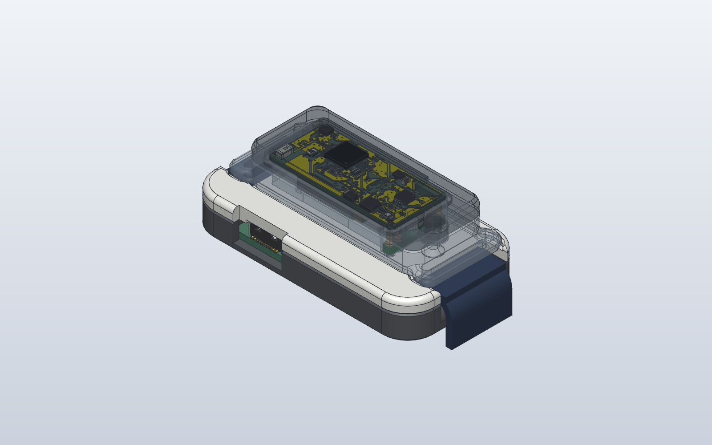
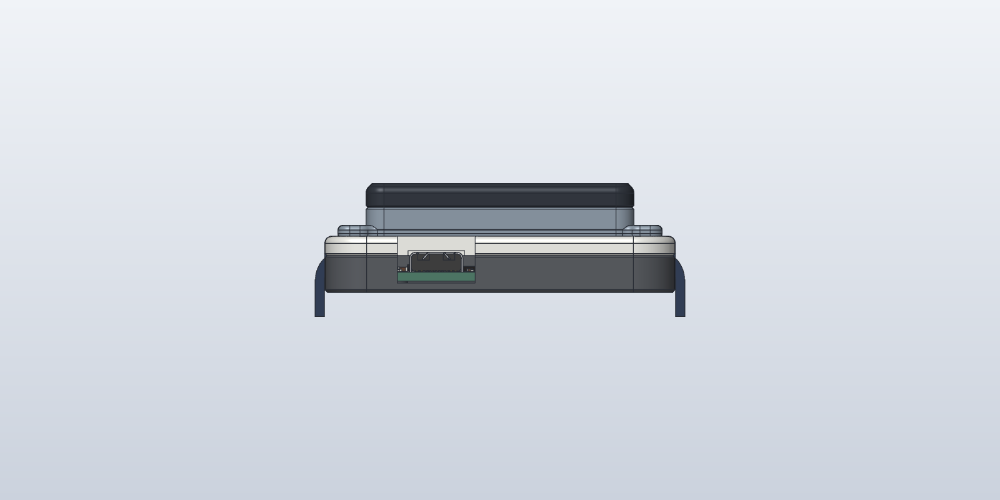
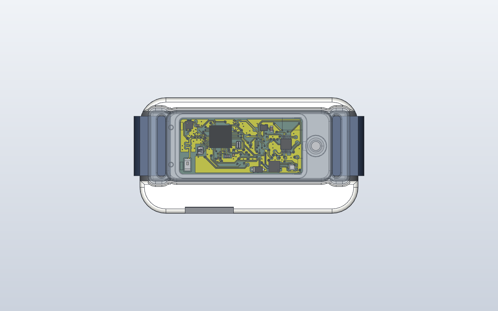
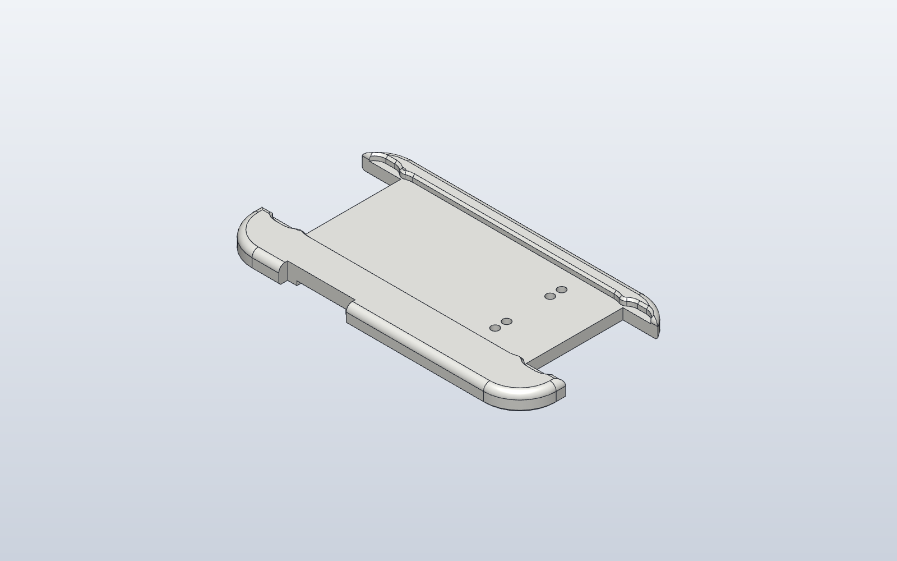
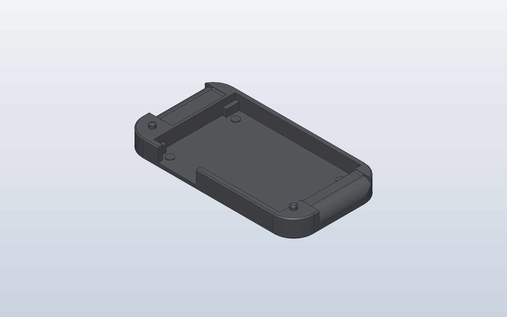
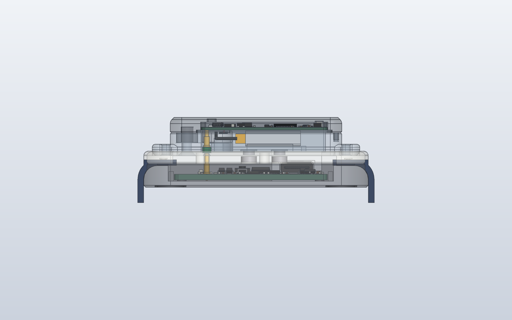

> **Superseded by rev C** (2026-11-08 review fixes): [`../../rev-c/case`](../../rev-c/case)

# WakeBand dock rev B

The charging and programming dock, restyled for everyday use. Same electronics as rev A: the dock PCB
in [`../pcb`](../pcb) (USB-C, RP2040 CMSIS-DAP probe, current-limited band power), the same four
spring-pin positions and the same keyed magnets. See the [dock PCB README](../pcb/README.md) for
the PCB, flashing the dock and programming the band.

**Size:** 58.6 x 31.1 x 9.4 mm (rev A 60.3 x 31.1 x 9.7).

## What changed from rev A

| | Rev A | Rev B |
| --- | --- | --- |
| Outline | 4 mm corners, square top edge | 7 mm corners, 1.2 mm round on the top edge, 0.5 mm chamfer at the bottom |
| Joint | top plate inside a raised tray rim: a step and a seam on top | top plate covers the whole outline and sits flush on the tray, located by two Ø2 mm pins on the tray's solid ends (snug Ø2.05 blind holes); the only joint is a fine shadow line on the side, 3.25 mm below the top |
| Strap | 18 mm box channels, sharp edges, open into the hollow inside | 18.6 mm channels (16 mm strap) with 0.5 mm floor rounds and 1 mm rounded lips, a **3.5 mm rounded saddle at each end** so the strap drapes down and out, and solid channel floors |
| LEDs | holes | shine through a **0.4 mm skin** (no holes) |
| BOOTSEL | poke hole on top | no hole (see below) |
| Magnets | Ø3 x 1 mm N52 | **Ø4 x 1.5 mm** (N42 from the buy list, or N52), pockets Ø4.1 x 1.55 from below, 0.2 mm skin, same positions and polarity |
| Recess | 1.5 mm deep | 1.2 mm deep with a 0.4 mm lead-in chamfer |
| Underneath | flat | four Ø8.2 mm locating rings (0.5 mm grooves) for Ø8 mm self-adhesive rubber feet; a full recess would print as an 8 mm bridge on the bed face |

**Why bigger magnets:** the dock spring pins changed to the stocked Mill-Max
**0906-4-15-20-75-14-11-0** (the low-force -72 is a factory special order). The -75 pushes about
60 g each at mid-stroke, 240 g for four, against 180 g for the -72 (1.33 x). Ø4 x 1.5 mm magnets pull
roughly twice as hard as Ø3 x 1 mm against the band's Ø3 x 1 mm magnets through the same gap. The buy
list has N42 magnets (Mouser has no small discs); N42 on both sides gives about 0.8 x the N52 pull, so
the rev B pair holds about 1.6 x what rev A's N52 Ø3 x 1 mm pair did, still ahead of the 1.33 x
pin force. This is an estimate, not a measurement. At
bring-up, tilt and tap the dock with the band in it: the band must stay seated and charging.

**BOOTSEL:** the button sits on top of the PCB, so it can't be reached from underneath without a PCB
change. A press-through skin would need about 1 mm of flex, which a printed skin won't give reliably.
So the top stays clean: flash the dock (dock PCB README, "Flashing the dock") **before** fitting the top
plate. To re-flash, lift the top plate off; it is held by the lip, so don't glue it.

## Parts

| File | What |
| --- | --- |
| `wakeband-dock-rev-b-top.step` / `.stl` | top plate (print this) |
| `wakeband-dock-rev-b-tray.step` / `.stl` | tray (print this) |
| `wakeband-dock-rev-b-magnets.step`, `-spring-pins.step` | fit-check models |
| `wakeband-dock-rev-b-strap-standin.step` | 16 x 1.5 mm strap stand-in for the previews |
| `dock_rev_b.py` | builds all of the above; `python dock_rev_b.py OUT_DIR [DOCK_PCB_STEP]` |

To buy (see `../../../band/rev-a/contact-carrier/BUY-LIST.md`): the dock PCB (`../pcb/fab`), 4 x Mill-Max
0906-4-15-20-75-14-11-0, 2 x Ø4 x 1.5 mm N42 (or N52) disc magnets, 4 x Ø8 mm self-adhesive rubber feet.

## Printing

PETG (or PLA: the dock is not worn), no supports.

| Part | Orientation | Notes |
| --- | --- | --- |
| Top plate | underside (flat, z -2.05) down | magnet pockets, LED windows and locating holes open downward; the only bridge is the 0.6 mm-high pocket over the USB-C shell (about 8 mm span), easy in PETG |
| Tray | floor down | no bridges; locating pins chamfered; foot rings are 0.5 mm grooves |

**Print check (2026-11-08, `../../../tools/printcheck.py`):** both parts are one solid with no fragments;
no face overhangs more than 45 degrees; no knife edges; no wall under 0.8 mm except the intended
0.2 mm magnet skins and 0.4 mm LED skins; the USB-C pocket is the only bridge over 5 mm.
- Print the top plate in a light or translucent colour so the LEDs show through the 0.4 mm skin.

## Assembly

1. Solder the four spring pins to the dock PCB (flanges flat), flash it, and lay it in the tray
   (USB-C into its opening).
2. Press the magnets into the top plate's pockets from below with a drop of CA glue: the one at
   x 112.5 **S up**, the one at x 120.5 **N up** (opposite to the band's). Check the band only seats
   one way round before the glue sets.
3. Press the top plate onto the tray's two locating pins, guiding the plungers into their bores.
4. Stick the rubber feet inside the four rings underneath.

## Checks (2026-11-08)

- Both printed parts are single valid solids; top plate and tray don't overlap.
- Clash check against the dock PCB's KiCad model (every part, now including the USB-C receptacle),
  the spring pins, the magnets and the band's wrist cover: **0 overlaps**. The USB-C shell (top 3.25 mm
  above the PCB) sits in a 0.25 mm-clearance pocket in the top plate; the BOOTSEL button is 0.7 mm
  under it.
- Spring pins at **mid-stroke** (0.70 of 1.40 mm) when the band is seated, as rev A.
